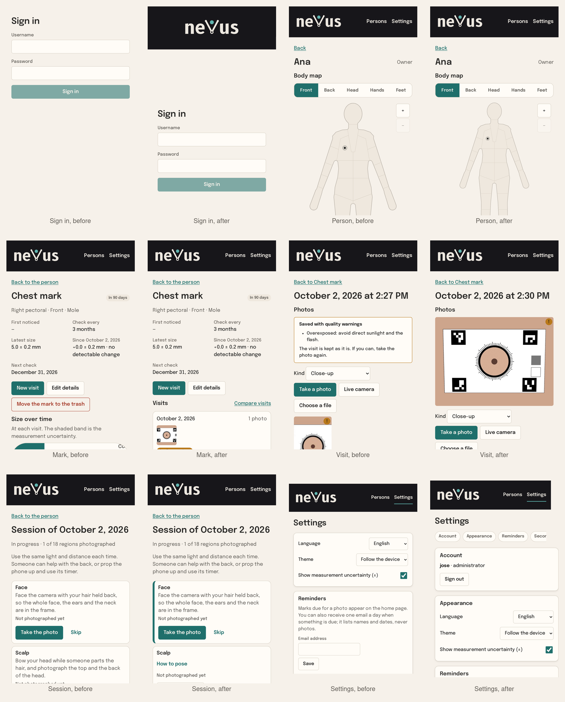
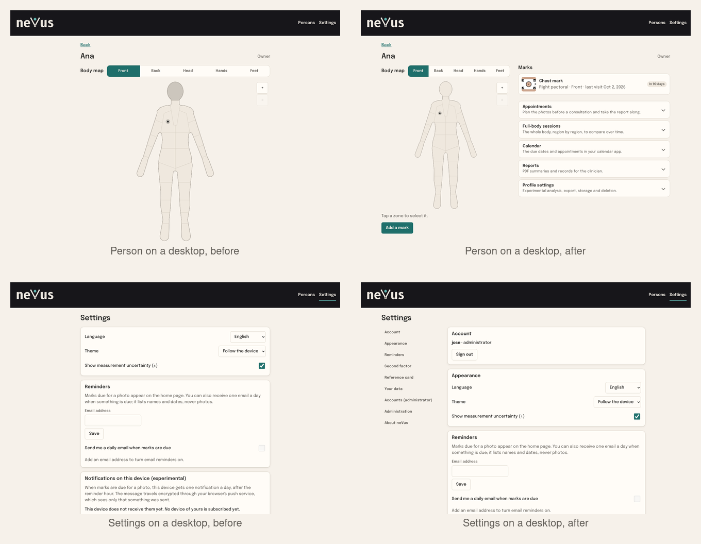
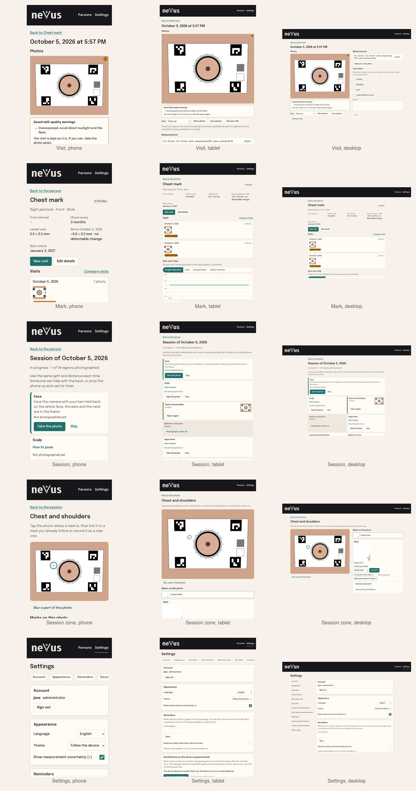
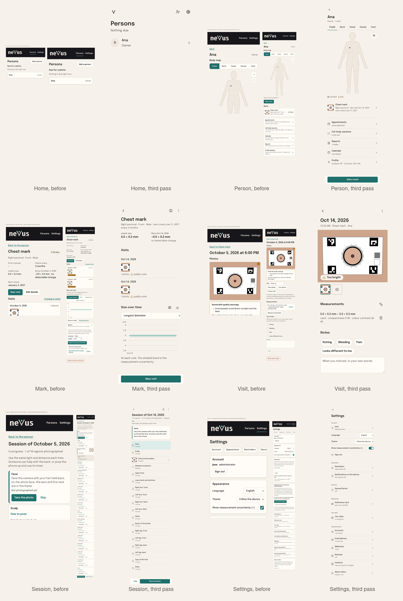
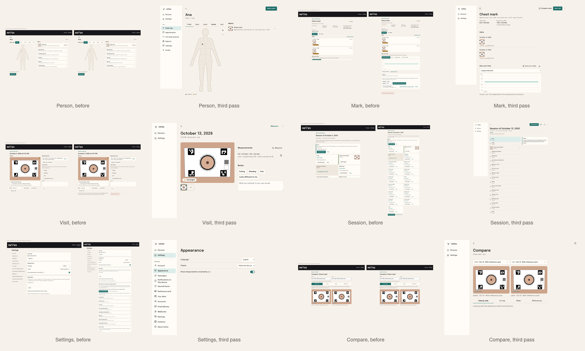

# Design review: every screen, 2026-10-02

A graphic designer's pass over the interface as it stood at 1.0.0, made with the screenshot gallery (`pnpm run shots`: every screen on a phone and on a desktop, light and dark) and the method of the design brief. It names what each screen must do, what was in the way, and what changed in 1.1.0. The brief itself is [`DESIGN_BRIEF.md`](DESIGN_BRIEF.md); this document is the review of what was built against it.

## Brief for the screens

- **Communicate:** observation, continuity, precision. **Never suggest:** alarm, a clinic, an emergency.
- **Where it lives:** a phone held in one hand (390 px wide, the thumb reaching the lower half) and a desktop window of 1280 px or more. Every screen must work on both.
- **Fixed:** the warm palette with one calm accent, Epilogue, the wordmark on dark paper, calm copy, a single accent for the selected element.
- **The Product Owner's words:** calm, not clinical, symmetric letterforms; and today, *optimise how information and the user's action are arranged and placed*.

## What the gallery showed

Six patterns, across screens:

1. **One long column everywhere.** The person page scrolled over 7,500 px on a phone: body map, marks, appointments, sessions, calendar, reports, profile, export and deletion, each spelled out in full with its own introduction. On a desktop the same column sat in the middle of an empty window.
2. **Too many primary actions.** The person page had five teal buttons (add a mark, prepare the appointment, start a session, make a calendar link, make the summary); the session page had eighteen (one per region). A primary button is a claim about what matters most; many claims cancel each other.
3. **Destructive actions next to the main ones.** "Move the mark to the trash" sat under "New visit"; "Move visit to trash" sat beside "Save". A slip of the thumb would have undone work.
4. **The photograph was not the hero.** On the visit page the photo was a 120 px thumbnail under a quality warning, a kind selector and three buttons; the brief says the photograph is the hero and the interface stays out of its way.
5. **The first action below the fold.** The body map filled the phone's viewport, so the hint and "Add a mark" were out of sight and out of the thumb's reach.
6. **Sign-in without the brand, sign-out at the end.** The sign-in pages were a bare form in the top-left corner; the settings page put the account and "Sign out" after every other card.

The things that were right stayed: the palette and its contrast, the type scale, the calm copy, cards for settings groups, badges in amber rather than red, the compare and measure tools, the empty states.

## Rules that came out of it

- **One primary action per screen**, placed where the eye and the thumb arrive after reading the content it acts on. Everything else is secondary (outlined) or quiet (text).
- **Destructive actions stand apart**: at the end of the page, behind a hairline, never in the row of the primary action.
- **Occasional tools fold.** A tool used once a season (appointments, sessions, calendar, reports, profile) shows its title and one line, and opens on demand; it opens by itself when something inside is live (an appointment ahead, a session in progress).
- **The content's own order.** A mark page is its visits first, then the trend, then the tools; a visit page is its photographs first, large, then what was measured on them, then the notes.
- **Two panes when there is room.** From 900 px the person page puts the body map on the left, sticky, and the marks and tools on the right; the settings page puts the list of sections on the left and the sections on the right.
- **The brand frames the entrance.** Sign-in pages carry the wordmark on its dark paper above a centred form and the tagline below, as the brief asked.

## Screen by screen

| Screen | Was | Now |
| --- | --- | --- |
| Claim, sign in, second factor, recovery | A form in the top-left corner of an empty page; no brand. | The wordmark on dark paper above, the form centred in the page, the tagline below; the `main` landmark kept. |
| Home | Due strip, then persons. | Unchanged. |
| Person | One column of eight sections; five primary buttons; the map taller than the viewport, the action below the fold. | Two panes from 900 px (map sticky left, marks and tools right). The map leaves room under it for the hint and "Add a mark", the one primary action. Appointments, sessions, calendar, reports and profile fold under their titles with a one-line hint; appointments open when one is ahead, sessions when one is in progress. |
| Person, placing a mark | Asked for a zone even when one was selected. | A selected zone is where the mark goes: the map zooms in on it and asks for the exact spot (fixed earlier today, with deselecting by tapping again or outside the body). |
| Mark | Chart, sightings and reports before the visits; the trash button beside "New visit". | Visits first, with "New visit" as the one primary action; then size over time, sightings, reports; the trash action last, apart, behind a hairline. |
| Visit | A quality warning, a kind selector and three buttons before a 120 px thumbnail; "Move visit to trash" beside "Save". | The photographs first, the first one the width of the page and never cropped; the quality note as its caption; the controls after; the trash action last, apart. |
| Measure | A two-step tool with its own panel. | Unchanged. |
| Compare | Selectors, views, synced photos. | Unchanged. |
| Session | Eighteen regions, each with its pose text and a primary button. | The next region to photograph leads, with its pose and the one primary button; the others keep their status and fold their pose under "How to pose". |
| Session zone, blur, sessions compare | Photo, marks, panel. | Unchanged. |
| Settings | Twelve cards in one column; the account and "Sign out" at the end; the first card without a heading. | The account first (name, role, sign out); every group with a heading; a list of the sections to jump to, as a row of pills on a phone and a sticky column from 900 px. |
| Trash, evaluation | Lists and a labelling tool. | Unchanged. |

## Boards

The first screen of each key page, before and after, at one scale:

The whole gallery is reproduced by `pnpm run shots` at any commit; the before set is the tree of `v1.0.0`. Two measures of the change on a phone: the person page went from 8,111 px to 4,113 px of scrolling, the session page from 10,563 px to 9,702 px; the settings page grew by a card (the account) and a row (the sections). The accessibility sweep of the gallery stays at zero findings.

## Second pass, 2026-10-05

Every screen again, at full size this time, on a phone and on a desktop (and, from this pass on, on a tablet: the gallery photographs three devices). What the first pass had left:

| Screen | Found | Changed |
| --- | --- | --- |
| Home | The due strip, a second-level heading, sat above the page's title. | The title and "Add a person" first; then what is due and the coming appointments; then the persons. |
| Mark | The reports kept a second primary button on the page; the chart's metric control overflowed the phone's width ("Colour contrast with the skin" cut off); the facts grid broke "since" into a narrow column on a desktop. | Reports fold under their title, as on the person page; the metric control wraps and the label is "Colour contrast"; the facts' columns are wider. |
| Visit | The quality note had landed after the controls and the privacy note, far from the photograph; three primary buttons (take a photo, measure, save); one long column on a desktop. | The note is the photograph's caption; the primary action follows the state (take a photo until there is one, measure until there is a measurement, save when something changed); from 900 px the photographs sit on the left, sticky, and the measurements and notes on the right. |
| Session | Eighteen regions in one column on a desktop. | Two columns from 900 px; the next region spans both. |
| Session zone | Photo, marks and panels in one column on a desktop. | From 900 px the photograph sits on the left, sticky, the marks and their panels on the right. |
| Settings | Fourteen cards in one column, 13,900 px on a phone; the administrator's groups the longest. | The occasional and administrative groups fold under their titles with a hint (second factor, reference card, your data, accounts, email delivery, webhooks, backups, instance); the list of sections opens the one it points to; account, appearance and reminders stay open. |
| Sign in | The wordmark larger than in the shell. | The shell's size. |

New rules from this pass: the primary action is a function of the page's state, not a fixed button; a control with several options wraps rather than overflows; a group of settings used once a season folds like a tool.

The five screens that changed most, after the pass, on the three devices the gallery photographs:

On a phone the settings page went from 13,873 px to 6,846 px of scrolling. The accessibility sweep stays at zero findings on all three devices.

## Third pass, 2026-10-14

The second pass had tidied the pages; it had not changed what they were. The Product Owner's verdict on the gallery was that the screens still read as web pages: a dark brand block at the top of every one, a back link under it, every unit of content in a bordered card, a row of buttons wherever an action could go, and paragraphs of explanation in the content column. Two independent documents were commissioned before anything was touched again: [`CONTENT_AUDIT.md`](CONTENT_AUDIT.md), an inventory of what every screen holds and which of it carries its weight, and [`REDESIGN_SPEC.md`](REDESIGN_SPEC.md), a specification of the structure each screen should have, with a rubric to score the result. This pass implements the specification, with the audit's decisions where the two differ (a camera on the due rows, the measuring tool skipping the scale step when the card is found).

What changed, for every screen at once:

| Pattern | Before | Now |
| --- | --- | --- |
| The top of the page | The wordmark on dark paper, two text links, a back link, then the title. | A 56 px app bar: the way back as a chevron named after the parent, the title once the page's own heading scrolls away, at most two icon actions and a "more" menu. The brand stays on the sign-in pages. |
| Actions | Two to five buttons in a row under the title; destructive ones in red at the end of the page. | One primary action, in a bottom bar on the phone and in the app bar on the desktop, chosen by the page's state. Occasional actions in the menu; destructive ones in the menu behind a confirmation. |
| Lists | Bordered, shadowed cards per item. | Rows separated by hairlines: a thumbnail, an initial or an icon, a title, one meta line, one trailing thing. |
| Occasional forms | Open on the page, or folded in disclosures. | Sheets, opened from the primary, a row or the menu: new mark, new person, add a photo, reports, appointments, accounts, webhooks, export, deletion. |
| The person's tools and the settings | Five disclosures under the map; fourteen cards. | Rows with a one-line status, each opening a sub-page; on the desktop the rail lists them next to the page. |
| Explanations | Paragraphs of two to five lines in the content column. | One line of at most ninety characters; the rest behind "Learn more" or the help icon. The quality warning is a chip on the photograph that opens the note. |
| Controls | Eleven interactive shapes. | Five: button, icon button, chip, segmented control as text with an underline, field (text, select, textarea, switch). |

The desktop gets a 240 px rail with Persons and Settings and a context block: inside a person, the body map and the five tools; inside the settings, the sections. The text column of a list page is 44 rem wide; the pages with a photograph or the map keep two panes from 900 px.

Before and after, on a phone and on a desktop:

### Scores against the rubric

The specification's rubric (ten criteria, 0 to 3 each, a screen passes at 24 with no criterion at 0) was applied by the designer to every screen on the phone and the desktop after this pass; the full table and the notes are in [`review/third-pass-evaluation.md`](review/third-pass-evaluation.md).

| | Phone | Desktop |
| --- | --- | --- |
| Screens scored | 31 | 31 |
| Pass (≥ 24, no 0) | 29 | 31 |
| Mean score | 26.7 | 28.1 |
| Lowest criteria | first viewport (c1), hierarchy and type (c7) | hierarchy and type (c7) |

The two screens below the line on the phone were the person page while placing a mark (23: the silhouette cut at the shins, a three-line instruction in the bar) and the zone photo while blurring (23: a three-line hint, a meta line repeating the title). The strongest were the sign-in family, the home, the trash and the settings; the mark and session pages on the desktop matched the specification's wireframes.

The review's fixes were applied in the same pass, in its order: the header-to-content gap on the phone (24 px); the map sized to the first viewport by height, not width; the sub-pages' descriptions moved behind the app bar's help icon so the line under the title is a status; one date format ("13 Oct 2026") everywhere; the helpers over ninety characters rewritten; the sign-in form centred on the desktop; the security pages' primaries in the bar; the rail's context block on every page inside a person; the compare pages across the whole width on the desktop; the home rows with a chevron; the settings reachable back from; the chart without its card; the measure page added to the gallery.

### Rules that came out of it

- The app bar holds the way back, at most two icon actions and the menu; nothing else. The content starts with the page's heading.
- Exactly one primary button per screen, and it follows the state of the page. When the page waits for a tap, the bar shows the instruction instead.
- A list is rows, never cards. Cards are for sheets, dialogs, the current region of a session and the experimental proposal.
- A form used once a season opens in a sheet. A destructive action lives in the menu, last, and asks once.
- A helper is one line. The explanation goes behind "Learn more" or the help icon, never in the column.
- An icon stands alone only for a universal action in the place where that icon is expected; a domain action is text.

The accessibility sweep of the gallery has no serious or critical finding on the three devices; the moderate "region" finding of the previous passes is closed by the app bar and the action bar being landmarks.

## Settled

The brief's bottom navigation bar, deferred by the previous passes, is settled by the specification: the information is deep, not wide, so the phone has no tab bar; the bottom bar holds the one primary action, and Settings is reached from the home page's app bar.
